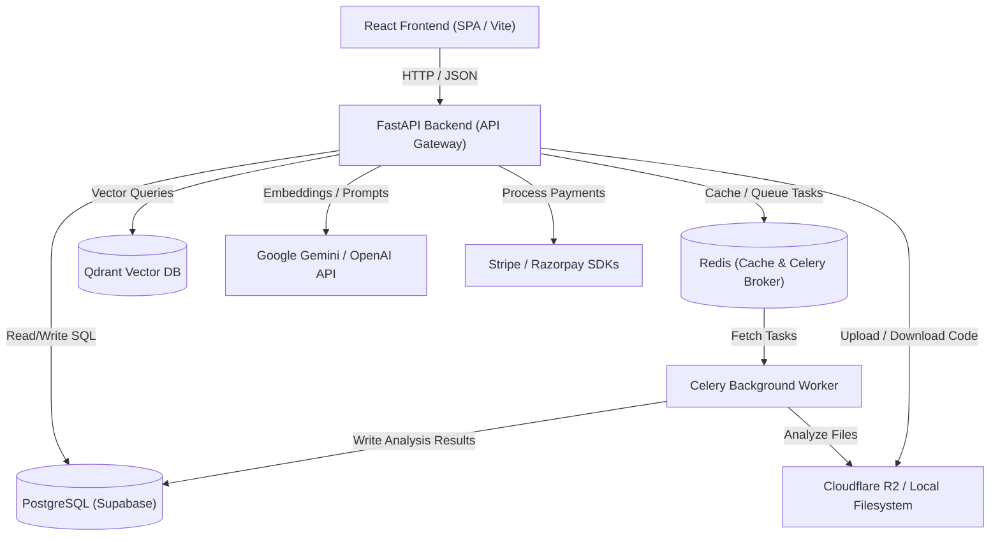
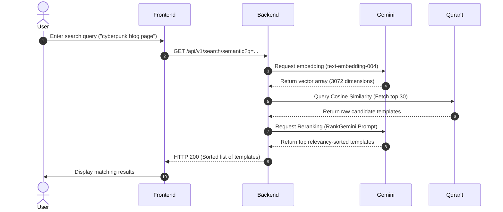
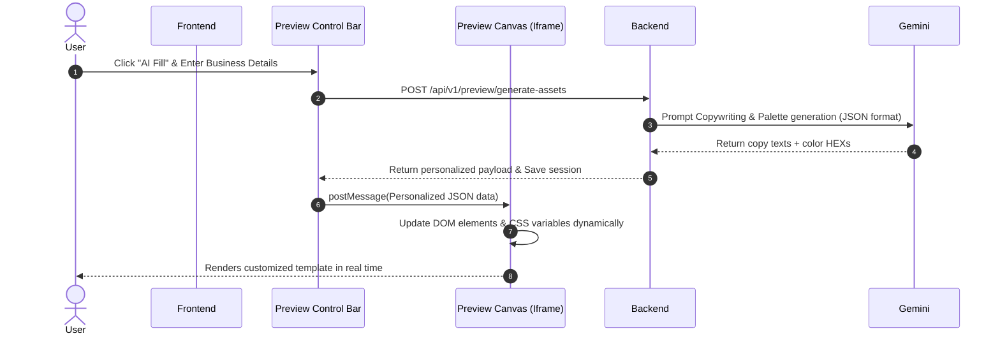
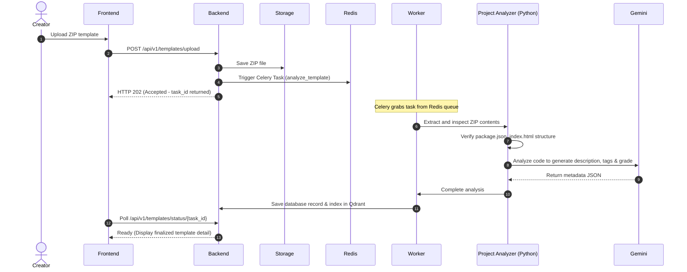
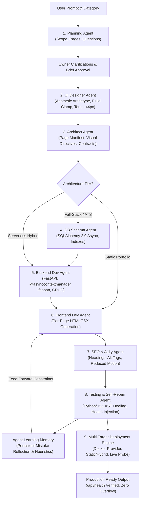

# 2. System Architecture & Flows

This document details the high-level system layout, components, and primary data workflows for **AI Site Studio**.

---

## Technical Component Architecture

The application is structured as a decoupled client-server architecture supported by relational/vector databases, caching structures, and asynchronous task workers:

### Component Details
1. **Frontend SPA**: React application styled with vanilla CSS, managed via Zustand stores. Handles rendering templates within custom sandbox preview structures.
2. **Backend API**: FastAPI application containing REST route boundaries, validation schemes (Pydantic), and database interactions (SQLAlchemy + asyncpg).
3. **Relational Database**: PostgreSQL managing users, standard metadata, preview sessions, payment status, and order tracking.
4. **Vector Database**: Qdrant housing template description embeddings (3072 dimensions) for sub-second semantic searches.
5. **Broker & Task Queue**: Redis managing session caches and driving Celery's background template analyzers.
6. **Object Storage**: Local disk or Cloudflare R2 bucket holding code template archives (ZIP) and screenshot image buffers.

---

## System Workflows

### 1. Semantic Search & RankGemini Pipeline

---

### 2. Live Customization & Preview (AI Fill)

---

### 3. Template Ingestion & Analysis Pipeline

---

### 4. Autonomous Multi-Agent Generation Engine (Agentic AI)

AI Site Studio implements an autonomous multi-agent software engineering pipeline where specialized agents collaborate in a staged, self-healing loop:

#### Specialized Agent Roles
1. **Planning Agent**: Analyzes user brief, detects domain/genre, determines optimal architecture tier (`single_page`, `multi_page`, `fullstack`), and generates domain-specific clarification questions.
2. **UI Designer Agent**: Emits tokens for **Premium Dark Luxe** (`#0B0D13`, glowing gradients, glass borders) or **Clean Modern SaaS** (`#FFFFFF`, slate text, diffused shadows), with fluid clamp typography and minimum 44px touch targets.
3. **Architect Agent**: Generates immutable page contracts, component boundaries, and embeds `visual_directive` across every page.
4. **DB Schema Agent**: Models PostgreSQL/SQLite entities using SQLAlchemy 2.0 async engine and `asyncpg`.
5. **Backend Dev Agent**: Generates production-ready FastAPI endpoints with `@asynccontextmanager lifespan` and Pydantic schemas.
6. **Frontend Dev Agent**: Constructs clean pages with dynamic contact/enquiry bindings (`contact_phone`, `contact_email`, motel room routing).
7. **SEO & A11y Agent**: Audits and auto-repairs heading levels, color contrast, keyboard access, and social tags.
8. **Testing & Audit Agent**: Analyzes Python/JSX AST syntax, heals unclosed delimiters, and injects mandatory `/api/health`.
9. **Packaging & Deployment Agent**: Builds multi-stage `Dockerfile`, `docker-compose.yml`, and conducts multi-probe health checks.
