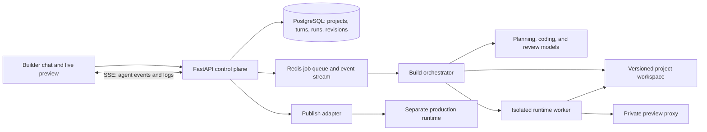

# ADR-001: Build Studio as a persistent agentic app workspace

**Status:** Proposed  
**Date:** 2026-10-28  
**Deciders:** AI Site Studio maintainers

## Context

Studio currently gathers a brief, generates a plan, asks several questions, and asks a model for one complete HTML document per page. It audits those documents, packages them in a ZIP, stores the ZIP on a private draft template, and only then opens the preview. Its AI edit endpoint can modify that saved archive, but there is no persistent, runnable project workspace, no install/build loop, and no live preview while the initial build is running.

This is not the workflow users mean when they ask for an Emergent-like builder. Emergent's public help describes a persistent chat-driven workspace where the agent reads conversation history, changes code, installs dependencies, refreshes a live preview, and iterates from user feedback. It also describes preview as a sandbox separate from production publishing. These are observable product behaviors; Emergent's private internal implementation is not public and is not a design input. [Workspace tour](https://help.emergent.sh/a-tour-of-the-workspace), [preview and iteration](https://help.emergent.sh/previewing-iterating), [chat-to-deployment flow](https://help.emergent.sh/the-chat-to-deployment-flow).

Studio needs to support both simple marketing sites and interactive full-stack web apps. JavaScript/TypeScript and JSON should be first-class project files, rather than code that is flattened into HTML. The system must execute untrusted generated code without exposing the API, database, secrets, or other users' projects.

## Decision

Replace the one-shot page-to-ZIP generation path with a persistent project workspace and an event-driven agent orchestrator. Keep template marketplace, ZIP export, existing account system, and deployment integrations as downstream capabilities.

The user journey is:

1. The user starts with a natural-language request in a persistent project chat.
2. A planning agent checks whether a decision blocks implementation. If so, it asks one concise question and pauses. Otherwise it records assumptions and continues. Page-specific questions are asked in context, one at a time.
3. The orchestrator creates or updates a real multi-file project. A coding agent uses bounded tools to inspect files, edit files, add dependencies, and run allowed build commands. It does not return a complete project as one giant model response.
4. Each meaningful change is saved as a revision. An isolated runner installs dependencies, starts the development server, runs build/type checks, and reports logs and errors to the agent.
5. The preview proxy exposes the running app to its owner. The user can browse it while the agent works, then send a follow-up message. Each turn reads the chat and the relevant current project files before applying a patch.
6. The user explicitly publishes a selected revision. Preview and production have separate runtime configuration, secrets, and data. A published revision is immutable until a new publish is confirmed.

### Target architecture

### Service responsibilities

| Component | Responsibility |
|---|---|
| Builder UI | Persistent chat timeline, one-question-at-a-time clarification, build status, file tree/diff, preview, rollback, publish confirmation. |
| FastAPI control plane | Authentication, project ownership, turn APIs, run lifecycle, streamed events, signed preview access, publish requests. It never executes generated code. |
| Project store | Immutable revisions plus a mutable working tree. Store source as files, not only a ZIP. Use object storage for snapshots/artifacts and a workspace volume or repository checkout for the active tree. |
| Orchestrator worker | State machine for clarify, plan, edit, install, run, validate, repair, preview-ready, failed, and cancelled. It persists every transition and bounds repair attempts. |
| Agent tool layer | Typed tools for list/read/write/patch files, inspect build output, and run approved commands in the assigned sandbox. Tool arguments and file paths are validated server-side. |
| Runtime runner | Per-project ephemeral container or stronger sandbox for dependency installation and app execution. Resource limits and network policy are enforced outside the model. |
| Preview gateway | Routes an owner-authenticated preview URL to the correct isolated runtime; stops idle previews and never exposes the runner control plane. |
| Publish adapter | Promotes an immutable successful revision to the existing configured host, with separate production secrets, health checks, and rollback metadata. |

### Project and run state

Persist at least these records:

- `StudioProject`: owner, name, requested app type, selected stack, active revision, preview runtime, production deployment reference, and lifecycle status.
- `StudioMessage`: project, role, content, attachments, tool-call metadata, and timestamps. Messages are append-only; corrections are new messages.
- `BuildRun`: initiating user message, state, worker lease, selected model/provider, token/cost metadata, current phase, bounded retry count, and final summary.
- `ProjectRevision`: parent revision, source snapshot reference, changed-file manifest, build result, and rollback target.
- `BuildEvent`: ordered progress/tool/log events for reconnectable streaming. Do not rely on an open SSE connection as the source of truth.

The first schema migration should add these tables and ownership indexes. Existing `Template` records remain the marketplace/export representation; they should no longer be the only persisted representation of a live editable project.

### Agent turn protocol

Every chat turn becomes a durable `BuildRun`. The planning stage returns one of: `ask_user` (a single blocking question), `continue` (record assumptions and start implementation), or `explain` (answer without changing code). The frontend must not ask all follow-up questions at once.

The coding agent receives a concise conversation summary, the latest user turn, project instructions, and only relevant files. It proposes tool calls; the server validates and executes each call in the runtime boundary. After edits, the run executes install/build/typecheck (and configured lint/unit/e2e steps), reads failures, and repairs within a small configured budget. A run cannot claim success when the command failed or no preview health check passed.

Events are durable and ordered: `run.started`, `phase.changed`, `question.asked`, `tool.started`, `tool.completed`, `file.changed`, `build.log`, `check.completed`, `preview.ready`, `run.completed`, `run.failed`, and `run.cancelled`. SSE reconnect uses an event cursor. A new user message cancels or queues behind the active run according to an explicit project policy; it must never race two writers against one workspace.

### Runtime and security boundary

- Never execute generated code, package lifecycle scripts, or model-suggested shell commands in the FastAPI or Celery process.
- Give each active build a disposable sandbox with a non-root UID, read-only base image, dedicated writable workspace, CPU/memory/PID/disk/time limits, and no host mounts or Docker socket.
- Deny access to cloud metadata, internal control-plane addresses, the Studio database, Redis, object-store credentials, and other project workspaces. Package downloads use a controlled egress proxy/allowlist.
- Keep user secrets in a separate encrypted secret store, inject only named project secrets at runtime, and never put them in prompts, logs, snapshots, or client-visible build events.
- Validate tool paths against the project root; reject traversal, symlink escapes, device files, oversized files, and dangerous archive entries. Scan exports before download.
- Require a successful build and preview health check before publish. Publishing is a separate user action; preview is never implicitly public production.

### Initial supported stack and website types

Start with a small, reliable scaffold registry instead of claiming every framework works on day one:

- Marketing/portfolio/content site: Vite + React + TypeScript, with static export when requested.
- Interactive full-stack app: Vite + React + TypeScript frontend, Node.js + TypeScript API, PostgreSQL, and documented environment variables.
- Preserve a plain HTML/CSS/JavaScript scaffold for the current lightweight site flow.
- Include `package.json`, lockfile, structured JSON data when appropriate, `.env.example`, README, health endpoint, and a deterministic dev/build command for each scaffold.

Add stacks only when their scaffold, runner image, preview routing, health checks, and publish adapter are implemented together. “Any framework” should be a scaffold/plugin capability, not an unverified promise made by the model.

## Options considered

### Option A: Keep single-shot HTML with a richer chat UI

| Dimension | Assessment |
|---|---|
| Complexity | Low |
| Cost | Low per run, but retries can waste tokens |
| Scalability | Good for small static sites only |
| Team familiarity | High; matches current implementation |

**Pros:** Reuses the existing preview, ZIP storage, and HTML generator. Easy to ship.

**Cons:** Cannot install packages, run backend code, maintain a live working tree, or validate a real app build. It would reproduce the surface conversation while missing the requested building mechanism.

### Option B: Browser-only code generation with client-side preview

| Dimension | Assessment |
|---|---|
| Complexity | Medium |
| Cost | Moderate |
| Scalability | Limited by browser and API constraints |
| Team familiarity | Medium |

**Pros:** Fast initial preview and no server-side runner fleet.

**Cons:** Poor isolation for arbitrary package installation and backend services; browser state is fragile; cannot provide production-like full-stack validation or durable background jobs.

### Option C: Persistent workspace, tool-using agent, isolated runner (selected)

| Dimension | Assessment |
|---|---|
| Complexity | High |
| Cost | Higher; requires workspace storage and ephemeral compute |
| Scalability | Good with queued runs and elastic sandbox workers |
| Team familiarity | Medium; builds on FastAPI, Redis/Celery, PostgreSQL, and current deployment services |

**Pros:** Supports real multi-file JavaScript/TypeScript projects, dependency installation, backend services, test/fix loops, live preview, history, rollback, and a separate publish lifecycle.

**Cons:** Requires durable run state, migrations, worker orchestration, secure code execution, runtime lifecycle management, and careful deployment integration.

## Trade-off analysis

Option C is the only option that addresses the requested backend process and building mechanism. The key cost is safe execution: a model-generated app is untrusted code, so running it in the API container or on a shared host directory is unacceptable. The sandbox and preview gateway are core product infrastructure, not optional polish. Keep the first release narrow by supporting two validated scaffolds and adding language/framework support through a registry.

## Consequences

- Chat history, build events, source revisions, and runtime state become first-class persisted data.
- Generation changes from “ask for a page” to “inspect, edit, run, observe errors, and repair” across multi-file projects.
- Studio must provide preview runtime lifecycle and publish/rollback behavior alongside the editor UI.
- Database and object-storage usage increases; idle sandboxes must be stopped and revisions/artifacts need retention policies.
- Existing static projects remain exportable and should be imported into the plain-site scaffold or retained as legacy drafts.
- Existing AI model provider configuration remains useful, but provider selection and fallback must be recorded per run so weak local fallback is visible.

## Action items

1. [ ] Add the project, message, run, event, and revision schema with migrations and ownership/retention rules.
2. [ ] Implement a durable orchestrator state machine on the existing Redis/Celery foundation; expose create-turn, run-status, cancel, and cursor-based event-stream APIs.
3. [ ] Build a sandbox runner service with one disposable runtime per active project and explicit resource/network limits.
4. [ ] Implement validated file and command tools, conversation summarization, clarification pause/resume, and bounded build/repair loops.
5. [ ] Add Vite React TypeScript and Node TypeScript scaffolds plus the plain-site scaffold; run the same deterministic health/build checks for each.
6. [ ] Add authenticated live-preview routing, project file/diff view, revision restore, and reconnectable progress in the workspace UI.
7. [ ] Connect successful immutable revisions to the existing publish path; preserve separate preview and production settings and user confirmation.
8. [ ] Migrate newly generated Studio projects to the workspace model while keeping ZIP export and legacy project access.
9. [ ] Add security, state-transition, build-loop, preview lifecycle, and publish rollback coverage before enabling generated-code execution in production.
